# 人工智能如何提升企业生产效率？——基于劳动力技能结构调整的视角

**姚加权　张锟澎　郭李鹏　冯绪**

*《管理世界》2024 年第 2 期 · DOI: 10.19744/j.cnki.11-1235/f.2024.0018*

**摘要**：人工智能技术对实现经济的高质量发展具有重要意义。现有研究多聚焦于人工智能对宏观经济的影响，本文从企业层面考察了人工智能技术如何影响生产效率和劳动力技能结构。本文运用机器学习方法生成了人工智能词典，并对上市公司的年报和专利进行文本分析，进而构建了企业层面的人工智能指标。研究发现，人工智能显著提升了中国上市公司的生产率，并且该结论在一系列稳健性检验后依旧成立。在影响机制方面，人工智能通过促使企业减少常规低技能劳动力需求、增加非常规高技能劳动力需求的方式提升企业的生产率，这体现了企业劳动力技能结构的调整。异质性分析表明，产权性质、人才获得方式、劳动力保障、治理结构等企业层面因素对人工智能的生产率效应有较大影响。此外，企业所处的行业和地区层面因素也影响了人工智能的生产率效应。最后，本文发现人工智能提高了企业价值。本文加深了对微观企业层面人工智能在生产过程中所扮演角色的认知和理解，并为在微观企业层面推动人工智能技术发展提供了建议。

**关键词**：人工智能企业生产率劳动力技能结构调整机器学习人工智能词典

## 一、引言

人工智能（Artificial Intelligence，AI）技术近年来迅速发展，已经成为推动科技跨越发展、产业结构优化升级、生产力整体跃升的重要驱动力量。多个国家把人工智能作为提升本国经济和产业核心竞争力的重大战略。党的二十大报告指出“推动战略性新兴产业融合集群发展，构建新一代信息技术、人工智能、生物技术、新能源、新材料、高端装备、绿色环保等一批新的增长引擎”。

《“十四五”数字经济发展规划》也提出“形成以技术发展促进全要素生产率提升、以领域应用带动技术进步的发展格局”。然而在微观企业层面，人工智能的使用能带来何种程度的生产效率提升，以及如何调整企业劳动力结构才能更好地发挥人工智能技术的效率提升作用，这些问题的答案尚不明晰。本文从企业微观视角出发，探索人工智能对我国企业层面生产效率的影响，以及研究企业如何针对人工智能对劳动力技能结构进行调整，对这些问题的回答有助于理解人工智能技术如何在企业层面发挥作用，对我国《新一代人工智能发展规划》落地实施、推动经济高质量发展具有重要的现实意义。

在宏观经济层面，已有文献通过构建理论模型发现人工智能促进了宏观经济增长（林晨等，2020；陈彦斌等，2019），增加了社会劳动力总需求（阿西莫格鲁、雷斯特雷波，2018a），对不同类型劳动力产生替代效应（郭凯明等，2023），以及通过实证研究发现人工智能技术有可能导致劳动力收入不平等（王林辉等，2020）。然而在企业层面，由于缺乏人工智能技术的有效观测指标，人工智能如何对微观企业的生产效率产生影响，以及人工智能如何改变微观企业的劳动力结构尚未有明确的结论。本文利用我国上市公司在年报中披露的人工智能信息，运用机器学习方法生成了人工智能词典，进而构建了企业层面的人工智能指标，对人工智能如何影响微观企业的生产效率进行了分析，并对相应文献不足进行了补充。

在企业层面，人工智能主要通过影响企业的劳动力技能结构进而影响企业的生产效率。一方面，人工智

研究规划基金项目（22YJA790079）的资助。冯绪为本文通讯作者。

*本项研究得到国家自然科学基金重大专项项目（72141304）、重点项目（72132002）、面上项目（72271184）、教育部人文社会科学

能技术用智能机器替代部分劳动力，从而降低企业的生产成本。人工智能赋予机器设备智能性，智能机器设备所具有的学习能力和自主决策能力对从事重复性工作的常规低技能劳动力具有替代性。随着企业用工成本逐渐提高，企业用人工智能技术替代常规低技能劳动力的可能性在逐渐增加。另一方面，人工智能技术能够提升非常规且富有创新性工作的技术水平，提高生产效率。企业需要更多具有创新能力的高技术人才和研发人才对人工智能技术进行应用和创新，最终可能引发对非常规高技能劳动力的需求增加。本文就“人工智能技术对企业生产效率的提升途径以及企业劳动力技能结构的调整过程”进行了充分讨论。

上市公司年报和专利文本中包含着企业采用人工智能技术的相关信息。本文采用机器学习方法生成了人工智能词典，通过对中国沪深A 股上市公司年报和专利进行文本分析，进而构建了企业层面的人工智能指标。研究结果表明，人工智能显著提高了中国上市公司的生产效率。经过倾向得分匹配（PSM）、工具变量法、“重点产业智能转型”作为准自然实验以及替代人工智能指标等稳健性检验后，该结论依然成立。在影响机制研究方面，为了发挥人工智能的生产率效应，企业会减少对常规低技能劳动力的需求，增加对非常规高技能劳动力的需求。进一步，本文从企业、行业以及地区3 个方面详细探讨了人工智能生产率效应的异质性。企业层面，人工智能的生产率效应在国有企业、技术型并购企业、劳动力保障较好企业、具有技术型董事会的企业中更加明显。行业层面，人工智能的生产率效应主要集中在高技术行业中。地区层面，较高的要素市场发展水平和较大的政府支持力度有利于发挥人工智能的生产率效应。最后，本文进一步检验了人工智能对企业价值的影响，发现人工智能显著提升了企业价值。

本文的贡献在于：第一，人工智能与经济学的交叉研究是目前学术研究的前沿领域。本文从文本分析的角度，采用机器学习方法生成了人工智能词典，构建了微观企业层面的人工智能指标，为后续进行微观企业层面人工智能的相关研究提供了一个有效的工具和度量方法的借鉴。第二，现有文献研究人工智能对生产率和劳动力的影响主要从宏观角度开展，重点考察了人工智能对中国的资本结构（林晨等，2020）、产业结构转型升级（郭凯明，2019）、劳动力供需（阿西莫格鲁、雷斯特雷波，2018a）、劳动收入分配（王林辉等，2020）等因素的影响。也有文献实证考察了工业机器人应用对中国劳动力市场的影响（王永钦、董雯，2020；余玲铮等，2021；李磊等，2021）。人工智能在微观企业层面的作用尚待进一步探索。本文着眼于微观企业层面，对人工智能如何影响企业的生产率进行了分析，并探讨了劳动力技能结构调整在其中发挥的重要作用。

在实践层面，党的二十大报告指出“加快建设现代化经济体系，着力提高全要素生产率”。在当前深化人工智能技术研发应用和壮大数字经济的背景下，本文加深了对微观企业生产过程中人工智能所扮演角色的认知和理解，为企业调整劳动力技能结构以更好地发挥人工智能的生产率效应提供指导，对如何在企业层面和政策层面发挥人工智能技术优势、提升企业全要素生产率给出了相关建议。

## 二、文献回顾与研究假说

作为新一轮科技革命和产业变革的重要驱动力量，人工智能在提高企业生产率、推动经济增长方面具有重大潜力（布林约尔松等，2017；弗曼、西曼斯，2019）。已有文献主要从宏观层面，采用动态一般均衡模型在理论上探讨了人工智能的影响，并基于中国情景通过数值模拟进行了定量分析。例如，陈彦斌等（2019）构建了含有人工智能和老龄化的动态一般均衡模型，研究发现人工智能提高了经济系统的全要素生产率，缓解了老龄化对经济增长的不利影响。林晨等（2020）构建了含有人工智能和异质性资本的动态一般均衡模型，研究发现人工智能可以提高经济系统生产的智能化程度以及全要素生产率，从而增强实体经济的吸引力，提高实体经济资本占比，有助于优化中国的资本结构。然而，人工智能相关数据的匮乏限制了在微观层面实证研究人工智能对微观企业的影响。以往文献考察了工业机器人应用对中国劳动力市场的影响。王永钦和董雯（2020）收集了国际机器人联合会提供的行业层面的机器人数据，采用制造业中单个企业生产部门员工占比与制造业所有企业生产部门员工占比中位数的比值作为权重，将行业机器人指标分解到企业层面，实证检验了工业机器人应用对中国制造业上市公司劳动力需求和工资的影响。余玲铮等（2021）基于广东省制造业“企业

—工人”匹配调查数据，实证检验了使用机器人对非常规任务工人相对工资的影响。李磊等（2021）通过收集2000~2013 年中国海关贸易数据库中机器人的进口数量和金额，研究了机器人对企业的就业效应。这些运用机器人指标的研究，有助于理解人工智能对劳动力市场的影响。本文基于文本分析方法构建了涵盖全行业（包括制造业）的企业层面的人工智能指标，从而更全面地捕捉人工智能技术因素，例如“机器学习”、

“语音识别”、

“自然语言处理”、

“计算机视觉”等，考察了企业层面人工智能对生产率的影响。

从理论层面，本文基于人工智能对劳动力的替代效应和互补效应两方面，探讨人工智能如何影响企业的劳动力技能结构进而影响企业的生产效率。

一方面，人工智能技术能够用智能机器系统替代部分劳动力，实现智能化生产，从而降低企业的生产成本，提高生产效率。人工智能最明显的特点在于它能赋予机器设备智能性，替代人类完成特定工作任务（徐鹏、徐向艺，2020；王军、常红，2021）。目前已经有越来越多的智能化设备或软件替代劳动力，从而减少企业的劳动力需求（阿西莫格鲁、雷斯特雷波，2018b；陈彦斌等，2019）。尤其对于高频、重复且规则明确的生产活动而言，智能设备的使用能够替代部分人工劳动，避免企业对相关劳动力的培训，降低成本，减少意外的人为错误，通过最小化差异保证生产过程和业务流程的一致性，这有利于提高企业的生产效率。

另一方面，人工智能技术能够促进非常规且创新型工作的技术水平，提高生产效率。人工智能以机器学习、深度学习算法为基础，通过更为复杂的逻辑思维过程，帮助企业免于认知和能力的限制，最终做出更加科学合理的决策（爱德华兹等，2000）。已有文献指出人工智能具备通用目的技术（General Purpose Technology，GPT）的三大条件，即能够被广泛使用，能够带来持续的技术创新以及能够在应用领域引发与之配套的创新活动（布林约尔松等，2017；戈德法布等，2023）。因此，人工智能在企业层面的应用可能会促进非重复、非常规且富有创新性工作的技术水平，激发劳动力的创新能力，提高生产效率。此外，随着资本积累和智能化程度的提高，人工智能技术与高技能劳动力结合还可能催生出更多新的就业岗位（阿西莫格鲁、雷斯特雷波，2018a，2019）。例如，人工智能工程技术人员和数字化管理师等。这些岗位使得人工智能技术能更好地应用于企业的生产经营活动，提高生产效率。

结合以上分析，本文提出假说1。

假说1：人工智能有利于提高企业的生产效率。

本文基于企业内部劳动力技能的视角，进一步从劳动力结构的角度分析人工智能与企业劳动力的关系。以往研究从劳动力学历的角度，划分劳动力技能，探讨了信息技术和工业机器人对劳动力结构的影响（何小钢等，2019；王永钦、董雯，2020）。然而，人工智能与不同技能水平劳动力之间的关系较为复杂，用受教育年限以及学历信息表征劳动力的技能水平有一定的局限性（奥特等，2003）。人工智能更大程度上体现的是任务偏向型技术进步，而非以教育衡量的技能偏向型技术进步（余玲铮等，2021）。不同职业要求的技能和工作方式有着各自的特点，与人工智能技术的适应程度也有所差别，人工智能对不同职业的劳动力将产生差异化的影响。布林约尔松等（2018）发现机器学习影响了绝大多数职业。弗雷和奥斯本（2017）利用美国劳工部职业分类数据（O*NET&SOC）研究了不同职业未来被计算机化的可能性，发现约47%的职业属于高风险职业。市场销售人员以及会计师和审计师等财务人员被计算机化的可能性较高，被替代风险均在90%以上。因此从职业角度分析人工智能与企业劳动力的关系更加合适。

根据人工智能对劳动力技能的潜在影响，本文将企业的劳动力划分为常规低技能劳动力（生产、业务、市场和财务人员）和非常规高技能劳动力（技术和研发人员）。其中，人工智能对于常规低技能劳动力主要体现为替代作用，对非常规高技能劳动力主要体现为互补作用。原因如下：

（1）生产人员。生产人员主要指传统意义上的蓝领工人，他们主要从事

在对常规低技能劳动力影响方面，一些简单重复且以体力为主的工作，例如从事生产、分拣、搬运工作的工人。与其他工作相比，生产人员的工作更具常规性、重复性和低技能的特点。企业可以使用机器设备或者智能系统替代生产人员的工作，而且人工智能还能实现柔性生产和全天候生产，并通过降低人为错误、改善生产工艺、提升成品率、降低劳动成本等

（2）业务人员。业务人员主要指从事辅助性和支持性工作的员工，例如仓库管理员、文秘、途径提高生产效率。人力资源职员等。企业技术研发部门提供人工智能技术进行大数据分析，能够实现从智能感知、分析决策到执行的全智能化过程，减少企业对辅助性和支持性员工的需求，提高业务效率

（3）市场人员。市场人员主要

指从事产品销售、市场营销等工作的员工，例如柜台收银员、推销员和广告公关人员等。对于市场人员而言，企业技术研发部门提供的人工智能技术通过收集客户交易、消费、网络浏览等行为数据，利用深度学习相关算法建模，有助于将销售渠道、人员、产品、客户等环节相连通，从而覆盖更多用户群体，并实现精准化和个性化

《2019 中国B2B 销售人工智能应用白皮书》显示，人工智能通过预测建模、挖掘潜在客户、识别市场机会服务。和提高数据质量等方式，有效提升了销售效率。此外，人工智能技术赋能销售行业，还催生了智能支付系统、智能客服、无人店以及智能配送等，进一步减少了企业对销售人员的需求。（4）财务人员。财务人员主要指从事会计和财务管理等工作的员工，例如出纳员、记账员和会计师等。对于财务人员而言，财务岗位的工作具有典型的程式化和重复性。人工智能衍生的商业智能和机器人流程自动化（RPA）可以运用到财务和会计领域，其具备的智能软件、机器学习和自然语言处理技术降低了企业对基础性财务工作人员的需求，并通过减少财务业务的操作时间，降低错误率的方式有效提升了财务工作的效率

在对非常规高技能劳动力影响方面，非常规高技能劳动力以企业的技术和研发人员为主，主要包括科研人员、程序员、工程师以及其他从事创新性工作的员工。弗雷和奥斯本（2017）的研究显示，技术和研发人员被智能机器替代的可能性较低。与其他职业相比，技术和研发人员属于需要人类启发知识以及发展新思想的通才型职业，他们需要具备更多的逻辑思维能力和想象力，并具备认知性和创新性的技能。人工智能技术在高技术部门创造了大量新的技术岗位（王林辉等，2020），例如人工智能架构师、人工智能算法工程师等，这些职业从事人工智能的项目设计、模型训练以及应用功能开发等工作，有助于提升机器设备的智能性和软件的性

能2023），这同样促进了企业对技术和研发人员的需求。

结合以上分析，本文提出假说2。

假说2：企业会通过减少对常规低技能劳动力需求、增加对非常规高技能劳动力需求的方式，实现劳动力技能结构的调整，进而促进企业生产效率提升。

## 三、研究设计

### （一）数据来源

本文以中国沪深A 股上市公司为研究对象，样本期间为2007~2018 年。选取2007 年为研究起点的原因在

《2017 年中国人工智能产业专题研究报告》指出，当前人工智能发展浪潮主要源于2006 年深度学习于：其一，算法的提出，在数据量和计算能力的基础上实现了大规模运算，属于技术上的重大突破，因此2007 年起，人工智能技术的优势可能会更加明显。其二，《2019 年中国人工智能行业市场前景研究报告》表明，2007 年后中国人工智能领域专利开始步入发展阶段，这使本文收集人工智能专利数据具备可行性。本文采用的上市公司年报来自新浪财经网站（https://finance.sina.com.cn/）；专利数据来自IRPDB 知识产权数据库（https://www.iprdb. com/）；劳动力相关数据来自锐思数据库（RESSET）；企业基本信息和财务数据来自国泰安数据库（CSMAR）。为了保证数据质量，本文对样本进行了如下处理：（1）剔除金融行业公司；

（2）剔除信息传输、软件和信息技术服务业以及科学研究和技术服务行业，原因在于这些行业天生使用云计算、大数据以及人工智能技术并披露相关信息，可能无法清楚判断这些企业应用人工智能技术对其生产效率的影响；

（3）剔除当年处于ST 和*ST 状

（4）剔除数据缺失的样本。最后得到18106 个观测值。为了消除极端值的影响，本文对连续变量在态的样本；1%的水平上进行了缩尾处理。

### （二）人工智能指标

以往多数文献采用调查问卷数据构建企业信息技术指标，本文没有采用该方法基于以下3 个原因：其一，

①。

②。

③。此外，人工智能还带来了持续的技术创新以及多应用领域的创新（布林约尔松等，2017；戈德法布等，

数据是通过对企业内部经理人发放调查问卷获得，这种方式容易产生“光晕效应（Halo Effect）”，即经理人回答问题的结果会受到调查问卷中问题的次序以及其他问题的影响。其二，调查问卷的调查数量有限，难以获得大样本的面板数据。其三，调查数据主要考察企业软硬件信息设备投资、IT 从业人数等，这些方面无法全面衡量企业人工智能技术的水平。上市公司年报描述了企业对人工智能技术的应用情况（如《管理世界》网络发行版附录表1 所示），上市公司申请的人工智能专利反映了企业人工智能技术的产出情况（如《管理世界》网络发行版附录表2 所示）。本文采用机器学习的方法生成了人工智能词典，进而分别基于上市公司年报和专利文

本构建企业人工智能指标

#### 1. 数据收集

新浪财经网站是国内比较权威的财经类网站，其收录的文本格式的上市公司年报易于获取和解析，而且经人工检查发现，新浪财经收录的上市公司年报较为全面。因此，我们选取新浪财经网站作为上市公司年报的数据来源，最终获取2007~2018 年中国上市公司28866 份年报。专利文本来自IRPDB 知识产权数据库，该数据库提供了较为全面的中国专利数据，通过其提供的应用程序编程接口（Application Programming Interface，API）可获得上市公司专利文本数据。本文共获得2007~2018 年中国上市公司1285563 份专利。

#### 2. 人工智能词典的生成

人工智能词典的生成步骤为：

（1）参考陈和斯里尼瓦桑（2020）提供的人工智能相关词语的中文翻译版、平安证券发布的《科创板系列——AI 产业链全景图》、中商产业研究院编制的《2019 年中国人工智能行业市场前景研究报告》、深圳前瞻产业研究院发布的《2019 年人工智能行业现状与发展趋势报告》等业界研究报告以及世界知识产权组织（World Intellectual Property Organization，WIPO）提供的人工智能词表，人工选取了“人工智能”、

“机器学习”、

“物联网”、“云计算”等52 个词语作为种子词（Seed Words）。（2）参考李等（2021），使用Word2vec（米科洛夫等，2013）技术，采用Skip-gram 模型，将年报和专利文本材料中的词语作为语料进行训练。根据种子词与输出词语之间的余弦相似度，针对每个种子词筛选出10 个与该种子词语义程度最相近的词语。（3）将重复词语、与人工智能不相关的词语以及词频过低的词语剔除，最终共获得73 个词语，生成本文的人工智能词典。人工智能词典的详细生成过程以及具体内容参见《管理世界》网络发行版附录二。

#### 3. 基于上市公司年报构建人工智能指标

由于中文文字之间没有空格切分，而且词语才是能够独立运用的最小语言单位，因此需要对年报文本进行专门的分词处理。我们使用广泛运用的Python 开源“jieba”中文分词模块对上市公司年报文本进行分词处理。中文文本分析存在3 个难点，即切分颗粒度、歧义词识别以及新词的识别（姚加权等，2020）。例如，

“机器学习”是人工智能的核心术语之一，但“jieba”分词模块会将其切分为“机器”和“学习”两个词语。为解决该问题，我们将生成的人工智能词典作为预设专有名词词典加入到“jieba”的分词模块并统计上市公司年报中人工智能词语的数量。采用上市公司年报中人工智能关键词数量加1 的自然对数（Lnwords）作为企业人工智能指标。

为了验证本文构建的企业人工智能技术水平指标的有效性，我们采用4 种方法考察了上市公司年报中人工智能词频与企业人工智能技术水平之间的关系。具体而言，第一，结合赛迪发布的《2019 赛迪人工智能企业百强榜研究报告》和同花顺网站上人工智能概念股名单进行检验。第二，对企业人工智能的不同指标进行相关性检验。第三，参考张叶青等（2021）的逻辑，我们将财务报表中的数资料来源：作者绘制。

图1 企业人工智能指标构建流程

④。构建流程如图1 所示。

字化投资指标与基于文本分析构建的人工智能指标进行回归分析。第四，寻找两名具有人工智能业界经验的从业者，让这两名从业者根据上市公司年报对上市公司的人工智能技术水平进行打分，然后和上市公司年报中人工智能的词频进行对比。以上4 种方法的详细内容参见《管理世界》网络发行版附录三。

此外，我们还基于上市公司年报“管理层讨论与分析”（MD&A）部分构建企业人工智能的替代指标。我国上市公司会以不同的形式展现MD&A，其中较多以“董事会报告”和“经营情况讨论与分析”以及“管理层讨论与分析”等关键词作为MD&A 的标题部分，并且MD&A 之后会紧跟着以“重要事项”和“监事会报告”以及“股份变动及股东情况”等关键词作为下一节的标题，满足这种结构的段落即为需要提取的MD&A 部分。我们采用正则表达式来提取年报中MD&A 部分。匹配以“董事会报告”或“经营情况讨论与分析”等关键词作为开头，以“重要事项”等关键词作为结束的段落，匹配完成后，将段落最后的结束关键词（正文中MD&A 下一节的标题）删除，只保留MD&A 的标题以及其内容，这样就完成了年报中MD&A 部分的截取⑤。进一步，采用上市公司年报MD&A 部分人工智能关键词数量加1 的自然对数（Lnwords_MD&A）作为企业人工智能的替代指标。

#### 4. 基于上市公司专利构建人工智能指标

企业申请的人工智能专利代表企业已经拥有的人工智能技术，反映了企业人工智能技术的产出情况，能够与年报相互印证企业的人工智能技术水平。我们在IRPDB 知识产权数据库获取了中国上市公司专利的标题、摘要、申请日期、申请人、分类号等信息。然后根据申请人信息将专利与上市公司信息相关联，通过查看公司当年申请专利的标题和摘要文本中是否涉及人工智能关键词来识别与人工智能技术相关的专利，并将其界定为人工智能专利，具体示例如《管理世界》网络发行版附录表2 所示。最终筛选出2007~2018 年中国沪深A股上市公司申请的12602 份人工智能专利文本。本文进一步采用上市公司当年申请的人工智能专利数量加1的自然对数（Lnpatents）重新度量企业人工智能。

### （三）企业生产率

本文采用全要素生产率（TFP）作为企业生产率的指标，全要素生产率不仅与技术进步相关，还反映了物质生产的知识水平、管理技能、制度环境以及计算误差等因素（鲁晓东、连玉君，2012），能够较好地衡量人工智能的生产率效应。全要素生产率的计算以柯布道格拉斯生产函数为基础进行估算：

（1）

β

α

Yi,t = Ai,tLi,tKi,t

其中，Y、L 和K 分别代表企业的产出、劳动力投入和资本投入，A 即为企业全要素生产率。通过对模型（1）取对数可以将该模型转化为如下线性模型（2）：

（2）

yi,t = αli,t + βki,t + ui,t

其中，y、l 和k 分别为Y、L 和K 的对数形式，残差项包含了企业全要素生产率A 的对数形式的信息。由于传统计算全要素生产率的OLS 方法存在同时性偏差（Simultaneity Bias）和样本选择性偏差（Selectivity and Attri-tion Bias）问题，本文参考谢谦等（2021），采用奥利和帕克斯（1996）的方法测算上市公司全要素生产率。在指标选取上，企业产出用销售总额的自然对数衡量，企业劳动力投入用企业员工人数的自然对数衡量，企业的资本投入采用固定资产净值的自然对数衡量。奥利和帕克斯（1996）的方法还涉及企业投资指标，该指标采用企

业购建固定资产、无形资产和其他长期资产支付的现金的自然对数衡量

### （四）人工智能生产率效应的研究模型

为了考察人工智能的生产率效应，本文建立如下回归模型（3）：

（3）

TFPi,t = α + βAIi,t + γControlsi,t + year + ind + pro + εi,t

其中，i 和t 分别代表公司和年份，TFP 为企业全要素生产率，AI 为人工智能指标，在基准回归中采用上市公司年报中人工智能关键词词频（Lnwords）衡量，在替代指标检验中采用上市公司年报MD&A 部分人工智能关键词词频（Lnwords_MD&A）以及上市公司当年申请的人工智能专利数量（Lnpatents）作为替代指标。根据假说1，本文预测回归系数β 显著为正。ε 为随机误差项，year、ind 和pro 分别代表年度固定效应、行业固定效应和省份固定效应。Controls 代表控制变量，参考赵健宇和陆正飞（2018）、叶康涛和孙苇杭（2019），本文纳入

⑥。

如下控制变量：公司规模（Size）、公司年龄（Age）、资产负债率（Leverage）、企业成长性（Growth）、董事会规模（BoardSize）、董事长与总经理是否两职合一（Dual）、股权集中度（Top1）、技术创新（Lnallpats）。为了缓解行业间的异方差问题，本文对模型中回归系数的标准误在行业层面进行了聚类（cluster）处理⑦。变量定义如表1所示。

## 四、实证分析

### （一）描述性统计

描述性统计结果如表2所示。Panel A 描述了不同年份中年报披露人工智能、年报MD&A披露人工智能以及申请人工智能专利的上市公司数量。其中，2007~2018 年间约26.72%的年报中披露了人工智能相关信息，约21.48%的年报MD&A 部分披露了人工智能相关信息，4.91%的上市公司申请了人工智能专利。根据Panel B，本文测算2007~2018 年间我国上市公司的全要素生产率（TFP）的均值为6.649，与谢谦等（2021）计算结果相似。上市公司年报中人工智能关键词词频（Lnwords）的均值为0.402，标准差为0.852，上市公司年报中MD&A 部分人工智能关键词词频（Lnwords_MD&A）的均值为0.280，标准差为0.674，上市公司每年申请的人工智能专利（Lnpatents）的均值为0.065，标准差为0.357，说明各企业之间人工智能水平相差悬殊（标准差均大于均值）。企业常规低技能劳动力（Routine）的最小值和最大值分别为0.000 和0.933，非常规高技能劳动力（Non_routine）的最小值和最大值分别为0.000 和0.670，说明上市公司之间的劳动力技能结构存在较大差异。

### （二）人工智能的生产率效应

表3 考察了人工智能的生产率效应。列（1）显示，人工智能（Ln-words）的回归系数为0.090，在1%水平上显著。列（2）显示，在加入控制变量后，人工智能（Lnwords）的回归系数依然显著为正。就经济意义而言，在控制其他因素后，企业人工智能水平Lnwords 每提高一个标准差，会使全要素生产率TFP提高3.24%（0.852×0.038），在经济意义上也是显著的。以上结果表

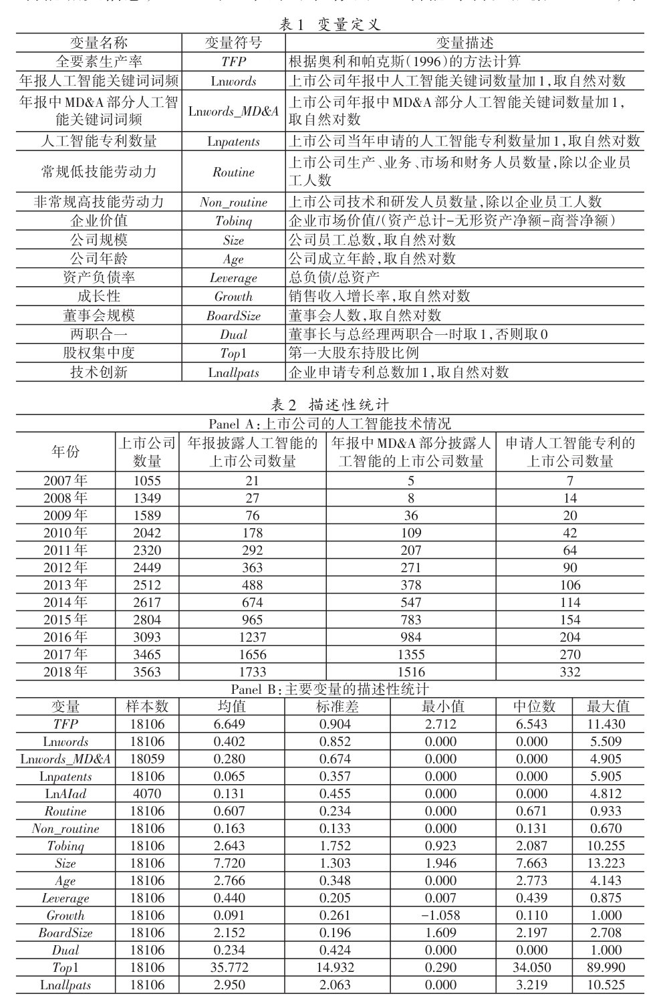

明，在其他条件一定的情况下，人工智能能够显著提高企业全要素生产率，这在一定程度上否认了索洛（1987）的“生产率悖论”，假说1 得到验证⑧。控制变量的回归结果与先前文献基本一致（赵健宇、陆正飞，2018；叶康涛、孙苇杭，2019）。例如，规模更大、资产负债率更高、成长能力更好以及股权集中度更高的企业的生产效率更高。

### （三）稳健性检验

#### 1. 倾向得分匹配法

企业引入人工智能并不是随机的，而是由人力资本、管理实践和技术水平等公司特征和外部环境的变化所决定，因此实证研究中可能存在样本的自选择偏差问题。为此，本文采用倾向得分匹配法（Propensity Score Matching，PSM）缓解内生性问题。具体地，我们根据年报中有无人工智能关键词将样本划分为实验组和对照组，以模型（3）中的控制变量作为匹配的标准，使用1∶1 有放回的最邻近匹配方法进行匹配。在PSM 回归前，需要进行平衡性检验，平衡性检验结果显示，实验组和对照组之间企业特征的标准误绝对值减少了59.9%~97.9%，匹配后大多数协变量的标准化偏差均小于5%且t 检验的结果不拒绝实验组和对照组的系数无显著差异的原假设，说明实验组和对照组的特征差异得到了较大程度的消除，匹配效果良好。对匹配后样本的检验结果如表3 列（3）所示，该结果说明在缓解自选择偏差问题的情况下，本文的研究结论依然稳健。

#### 2. 利用工具变量缓解内生性

本文进一步采用工具变量来缓解可能存在的内生性问题。基于清朝通商的历史事件构造企业人工智能的工具变量，具体工具变量的处理及合理性说明如下：

参考范等（2013）、林建浩和赵子乐（2017）以及蔡贵龙等（2018），我们采用1840 年至清朝末期该城市是否开设通商口岸（SEA_PORT）构建工具变量。一个城市是否曾经作为通商口岸可能影响当地企业技术的应用，而不会直接影响现阶段当地企业的生产效率，因此该变量满足工具变量的相关性和外生性条件。具体地，企业所在城市自1840年至清朝末期被开设为通商口岸则定义SEA_PORT 为1，否则为0。由于本文的研究样本是企业—年份层面的面板数据，而通商口岸的开设是不随时间变化的变量。为此，本文参考纳恩和钱（2014）关于双维度工具变量的处理方式，采用每年全球人工智能专利的申请数量来体现工具变量的时变性。全球人工智能专利的申请数量可被视为全球人工智能技术发展的平均水平，仅通过影响人工智能技术水平进而对企业生产效率产生影响。因此，1840 年至清朝末期企业所在城市是否开设通商口岸与样本中t-1 年全球人工智能专利申请数量自然对数的交乘项满足工具变量的相关性和外生性条件。本文采用SEA_PORT 和样本中t- 1 年全球人工智能专利的申请数量自然对数的交乘项（SEA_PORT×LnAI）作为工具变量。另外，在回归模型中还控制了城市人均GDP 以避免城市经济发展水平的影响。表4 为两阶段最小二乘估计方法（2SLS）的回归结果，第一阶段回归结果显示，工具变量（SEA_PORT×LnAI）的回归系数为0.024，在1% 水平上显著。此外，Cragg-Donald Wald F 统计量明显大于Stock-Yogo 弱工具变量检验的临界值，说明模型不存在弱工具变量问题。Anderson LM 检验显著拒绝

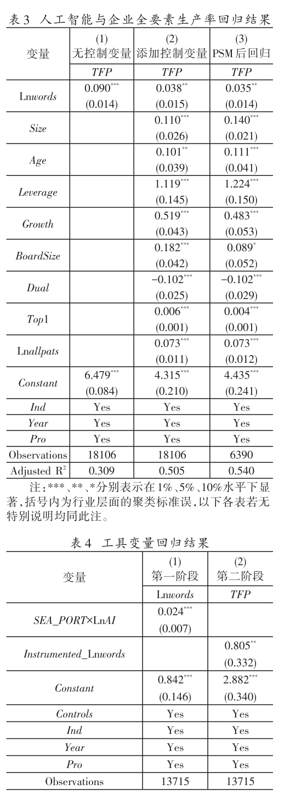

“工具变量识别不足”的原假设，说明模型不存在识别不足问题，工具变量对内生变量具有较强的解释力。第二阶段回归结果显示，Instrumented_Lnwords 的回归系数显著为正。该结果再次印证本文的研究结论是稳健

的

#### 3. 基于PSM-DID 的检验

本文进一步采用《智能制造发展规划（2016-2020 年）》中提出的重点产业智能转型作为准自然实验，采用PSM-DID 方法缓解人工智能与企业生产率的内生性问题。2016 年我国工业和信息化部、财政部联合制定的《智能制造发展规划（2016-2020 年）》

动了重点产业的智能转型，为所属重点产业的企业引入人工智能技术提供了战略支撑和保障。DID 模型如模型（4）所示：

TFPi,t = β0 + β1Treati × Postt + γControlsi,t + year + ind + pro + εi,t

（4）

《智能制造发展规划（2016-2020 年）》文件中提到，要推动高档数控机床与工业机器人、航空装备、海洋工程装备及高技术船舶等重点产业的智能转型。据此，将所属重点产业的企业归为实验组，定义Treat 为1，将其他企业归为对照组，定义Treat 为0。选取政策文件颁布前后3 年的样本数据作为测试数据，将政策文件颁布前的样本定义Post=0，政策文件颁布后的样本定义Post=1。由于模型中控制了行业固定效应ind 和年度固定效应year，因此不再控制Treat 和Post 虚拟变量，控制变量Controls 的设定同前文所述一致。运用PSM-DID 方法时，首先根据虚拟变量Treat 对模型（4）的控制变量进行Logit 回归计算倾向得分值，根据倾向得分值最接近的企业作为实验组企业的配对企业，进而最大程度地减少不同企业之间的系统性差异，缓解DID 估计的偏差。以模型（4）中的控制变量作为匹配的标准，使用1∶1 有放回的最邻近匹配方法进行匹配。平衡性检验结果显示，实验组和对照组企业特征的标准误绝对值减少了53.5%~95.0%，匹配后大多数协变量的标准化偏差均小于5%且t 检验的结果不拒绝实验组和对照组的系数无显著差异的原假设，说明实验组和对照组的特征差异得到了较大程度的消除，匹配效果良好。在大幅度降低实验组和对照组企业的特征差异后，采用匹配后的样本进行回研究结论依然保持稳健。

#### 4. 其他人工智能指标的检验

智能（Lnwords_MD&A）的回归系数分别为0.109 和0.049，均在1%水平上显著，该结果表明本文研究结论仍然成

⑪。立

为了进一步保证研究结果的稳健性，本文从人工智能技术产出的角度，基于上市公司当年申请的人工智能专利数量加1 的自然对数（Ln-patents）重新度量企业人工智能，回归结果如表6 的列（3）和（4）所示，加入控制变量前后，人工智能（Lnpatents）

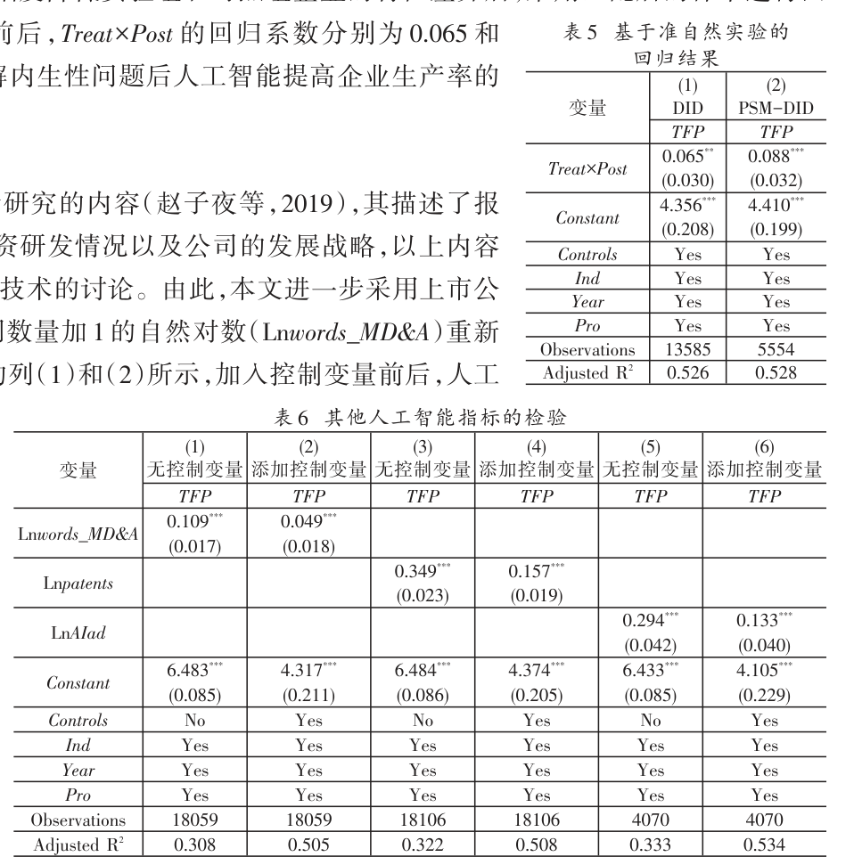

⑨。

⑩指出，有条件、有基础的重点产业智能转型要取得明显进展。该政策推

的回归系数分别为0.349 和0.157，均在1%水平上显著，该结果表明本文研究结论仍然成立。

另外，本文收集了智联招聘2017 年和2018 年上市公司的招聘广告数据，从人工智能投入的角度，结合人工智能词典识别了人工智能相关的招聘广告，采用上市公司当年发布的人工智能招聘广告数量加1 的自然对数（LnAIad）重新度量企业人工智能水平⑫。回归结果如表6 的列（5）和列（6）所示，加入控制变量前后，人工智能（LnAIad）的回归系数分别为0.294 和0.133，均显著为正，本文的研究结论得到进一步验证⑬。

### （四）人工智能生产率效应的机制研究

人工智能技术对常规、重复性劳动岗位具有替代作用，对非常规、非重复性劳动岗位具有互补作用，因此企业会通过降低对常规低技能劳动力的需求，提高对非常规高技能劳动力的需求的方式发挥人工智能的生产率效应。我们参考巴伦和肯尼（1986）经典的中介效应模型，基于“劳动力技能结构调整”的机制路径进行实证检验。该方法已经广泛应用到影响机制的研究中（何瑛等，2019；施炳展、李建桐，2020；唐松等，2020；李磊等，2021）。具体研究模型如下：

TFPi,t = γ0 + γ1AIi,t + γiControlsi,t + year + ind + pro + εi,t

TFPi,t = θ0 + θ1AIi,t + θ2Labori,t + θiControlsi,t + year + ind + pro + εi,t

（5）

（6）Labori,t = δ0 + δ1AIi,t + δiControlsi,t + year + ind + pro + εi,t

（7）

其中，Labor 为企业劳动力指标，参考奥特等（2003），包括常规低技能劳动力（Routine）和非常规高技能劳动力（Non_routine），其中常规低技能劳动力采用生产、业务、市场和财务人员数量除以企业员工人数衡量，非常规高技能劳动力采用技术和研发人员数量除以企业员工人数衡量词频（Lnwords）衡量。ε 为随机误差项，year、ind 和pro 分别代表年度固定效应、行业固定效应和省份固定效应。控制变量Controls 的设定同前文所述一致。模型（5）中AI 的系数γ1反映了人工智能技术对企业生产率的总效应。模型（6）中AI 的系数δ1反映了人工智能技术对企业不同类型劳动力（常规低技能劳动力和非常规高技能劳动力）的影响。基于理论分析，当被解释变量为常规低技能劳动力时，预计AI 系数δ1显著为负，说明人工智能替代了企业常规低技能劳动力；当被解释变量为非常规高技能劳动力时，预计AI 系数δ1显著为正，说明人工智能技术提高了企业对非常规高技能劳动力的需求。模型（7）在模型（5）的基础上添加了企业劳动力指标Labor，此时AI 的系数θ1表示人工智能对企业生产率的直接效应，而Labor 的系数θ2表示控制AI 后不同类型劳动力对企业生产效率的影响

中介效应模型的逐步回归结果如表7 所示。表7 的Panel A 列（1）显示，人工智能显著促进了企业的生产效率，且人工智能对企业生产效率的总效应为0.038。表7 的Panel A 列（2）表明，人工智能显著降低了企业对常规低技能劳动力的需求，即人工智能替代了常规低技能劳动力。表7 的Panel A 列（3）中，Lnwords 的系数显著为正，Routine 的系数显著为负。进一步对中介效应进行检验，由Sobel检验和Goodman 检验得知，部分中介效应存在，中介效应的比例为28.241%，验证了人工智能通过替代企业常规低技能劳动力从而提升企业的生产效率。同理，表7 的Panel B 显示，列（2）中Lnwords 的回归系数显著为正，说明人工智能技术显著提高了企业对非常规高技能劳动力的需求，列（3）中Lnwords 的系数显著为正，Non_routine的系数显著为正，根据Sobel 检验和Goodman 检验得知，部分中介效

⑭。AI 为人工智能指标，用人工智能关键词

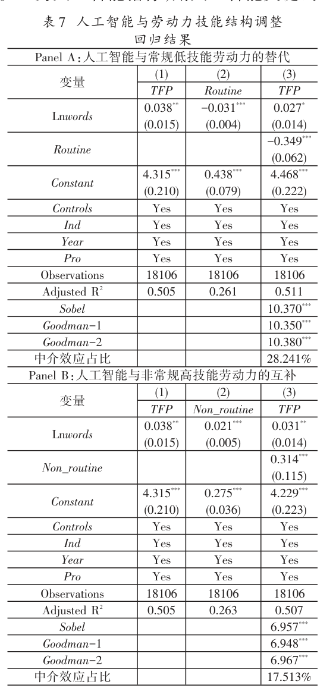

⑮。

应存在，中介效应比例为17.513%，说明人工智能通过与企业非常规高技能劳动力形成互补，从而提升企业生

⑯。产效率

## 五、进一步研究

上述结论发现人工智能技术通过对常规低技能劳动力的替代效应和对非常规高技能劳动力的互补效应，提高企业的生产效率。考虑到企业之间在产权性质、人才获取方式、劳动力保障、治理结构、行业属性以及地区特征等方面存在显著差异，本部分探讨了人工智能的生产率效应在异质的企业、行业和地区中的不同表现。另外，本文还考察了人工智能对企业价值的影响。

### （一）企业异质性分析

人工智能的生产率效应在国有企业和非国有企业之间可能存在差异。与非国有企业相比，国有企业在执行政府政策时更加坚决，对政府政策的引导更有行动力。此外，企业技术研发部门研究和开发人工智能技术不仅需要硬件的投入，更需要掌握人工智能技术的高端人才，这提高了企业的资金压力和人才需求。国有企业具有更丰富的资源和更高的风险承担水平，因此国有企业更有能力加强人工智能的互补性投资以提升人工智能的生产率效应。基于此，我们根据实际控制人属性，将企业划分为国有企业和非国有企业。表8 的列（1）和列（2）中Lnwords 的回归系数均显著为正，但相比非国有企业，国有企业的Lnwords 回归系数明显较大，经由Bootstrap 法1000 次得到的组间回归系数差异的经验p 值为0.000，这证实了Lnwords 回归系数在国有企业和非国有企业之间具有显著性差异。以上结果表明，人工智能对国有企业和非国有企业的全要素生产率均有提升，其中对国有企业的提升作用更显著。

数字经济时代，许多企业开始将目光转移至企业外部，通过并购的方式，来快速获得被并购方的资产、知识技能以及人才（颜士梅，2012）⑰。当企业的劳动力技能结构无法满足智能化转型的要求以及企业面临较高的劳动力调整成本时，企业通过并购的方式可以更快速地实现非常规高技能劳动力的提升，完成劳动力结构调整过程。由此，本文将样本划分为技术型并购企业和非技术型并购企业。我们从两方面定义技术型并购：一方面，若并购交易简介的文本内容中包含本文构建的人工智能词典中的关键词，则界定为技术型并购；另一方面，若被并购企业属于信息传输、软件和信息技术服务业或计算机、通信和其他电子设备制造业，则界定为技术型并购。本文参照赵烁等（2020）的做法，设置3 年的窗口期。若企业在当年、前一年或前两年内发生过技术型并购则定义为技术型并购企业，否则为非技术型并购企业。回归结果如表8 的列（3）和列（4）所示，Ln-words 的回归系数均显著为正，但相比非技术型并购企业，技术型并购企业的Lnwords 回归系数明显较大，经由Bootstrap 法1000 次得到的组间回归系数差异的经验p 值为0.000，这证实了Lnwords 回归系数在技术型并购企业和非技术型并购企业之间具有显著性差异。以上结果表明，技术型并购有助于更显著地提高人工智能的生

⑱。产率效应

劳动力保障也是企业发挥人工智能生产率效应的重要条件。企业与员工之间的劳动争议在一定程度上体现了企业的劳动力保障程度。人工智能技术的研发和应用属于企业技术创新行为，具有一定的风险性。提高劳动保障有助于增强员工创新的努力程度，并鼓励企业投资于有风险但会打破常规的项目（阿查里亚等，2014）。此外，人工智能技术需要通过企业调整劳动力技能结构才能有效提升生产效率。在劳动力技能调整过程中，企业与员工之间较多数量的劳动争议案件意味着企业无法给员工提供有效的劳

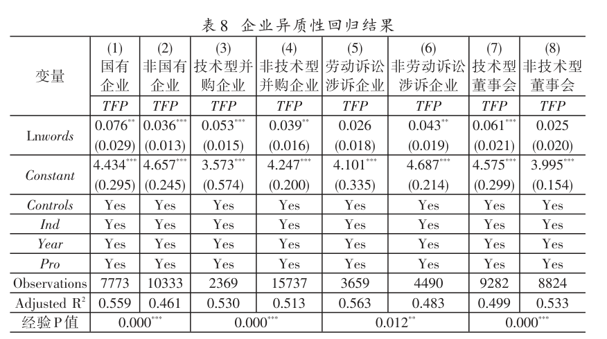

动保障，员工不认同企业的安排，此时企业在劳动力结构调整过程中面临较大的阻力，从而可能无法有效发挥人工智能的生产率效应。本文进一步根据企业当年是否发生过劳动诉讼（即是否劳动诉讼涉诉）划分样本。回归结果如表8 的列（5）和列（6）所示。发生过劳动诉讼的企业样本中，Lnwords 的回归系数不显著，而未发生过劳动诉讼的企业样本中，Lnwords 的回归系数显著为正。以上结果表明，提高劳动保护有助于企业更顺利地

⑲。调整劳动力技能结构，进而更好地发挥人工智能对企业生产率的积极作用

治理结构在企业人工智能技术使用决策方面发挥的作用同样不容忽视。根据高阶理论（Upper Echelons Theory），具有技术背景的董事可能对创新型人才更加重视，并凭借其技术专长和技术经验指导企业创新项目

⑳。另外，人工智能技术需要拥有专业知识和技能的劳动力才决策，进而将人工智能引入到企业的生产过程中能更好地发挥作用。根据资源依赖理论，具有技术背景的董事可以为企业提供更多的专业技能、知识和经验等资源禀赋，提高企业的创新效率。而且，具有技术背景的董事还可以与其他技术专家、创新企业建立关系网络，从而增强企业之间的创新协作、降低交易成本，进而有利于技术创新的顺利进行（胡元木、纪端，2017）。参考朱焱和王广（2017），本文将具有技术背景的董事定义为：（1）该董事具有生产、研发或设计的职业背景；（2）该董事具有工程师或研究员的相关技术职称。根据企业董事会中具有技术背景董事人数比例的中位数，将样本划分为技术型董事会和非技术型董事会进行分组检验。回归结果如表8 的列（7）和列（8）所示，该结果显示，人工智能对企业生产率的影响在具有技术型董事会的样本组中更显著，这说明技术型董事的技术经历和专长有利于人工智能生产率效应的发挥。

### （二）行业异质性分析

不同行业中，人工智能的生产率效应也可能存在差异。高技术行业中，技术创新是其核心竞争力。政府的财税激励政策和税收优惠政策也对高技术行业的研发创新和产业增长产生了积极影响（张同斌、高铁梅，2012）。与低技术行业相比，高技术行业往往具备更多的高技能劳动力、更先进的技术和知识以及更快的研发速度。因此，在高技术行业中，人工智能能够与更多的高技能劳动力相结合从而提高企业生产效率。为了区分行业的异质性影响，本文参考国家统计局发布的《高技术产业（制造业）分类（2017）》和《高技术产业（服务业）分类（2018）》，将行业划分为高技术行业与低技术行业。分组回归的结果如表9 显示，人工智能的生产率效应主要集中在高技术行业中。该结果进一步印证了人工智能通过与高技能劳动力形成互补效应，进而促进企业生产效率的提高。

### （三）地区异质性分析

中国各地区的要素市场发育程度和政策支持力度具有较大差异，不同地区的经济基础和资源禀赋也不同，这很可能导致部分地区的企业在资金、人力资本、技术创新等方面的投资不足，最终影响人工智能的生产率效应。对此，本文从要素市场发育程度和政策支持力度两个方面进行分组检验。具体而言，本文依据王小鲁等（2019）发布的《中国分省份市场化指数报告（2018）》中公布的要素市场的发育程度指数排序，将样本划分

1。其中，要素市场的发育程度从当地金融为要素市场发育程度高的地区和要素市场发育程度低的地区两组业的市场化、人力资源供应条件和技术成果市场化3 个方面考量。要素市场的发育程度越高，说明企业能够

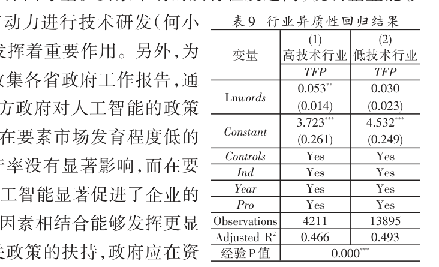

更灵活地调整资金，更容易招聘到高技能劳动力，更有动力进行技术研发（何小钢等，2019）。这3 个方面均对人工智能的生产率效应发挥着重要作用。另外，为了衡量不同地区的政府对人工智能的支持力度，我们收集各省政府工作报告，通过考察人工智能是否写入各省政府工作报告来衡量地方政府对人工智能的政策

2。表10 为分组后的回归结果。该结果显示，在要素市场发育程度低的

支持力度地区和政府支持力度小的地区，人工智能对企业的生产率没有显著影响，而在要素市场发育程度高的地区和政府支持力度大的地区，人工智能显著促进了企业的生产率。表10 结果表明，人工智能与资金、人力资本等因素相结合能够发挥更显著的作用。另外，人工智能的生产率效应需要政府相关政策的扶持，政府应在资

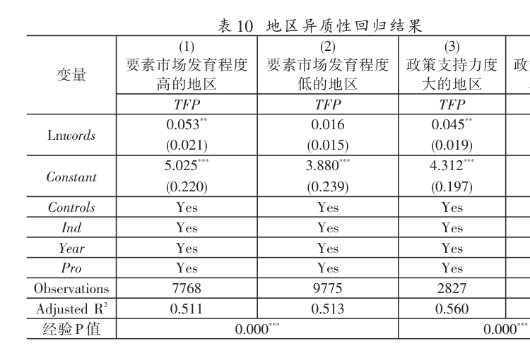

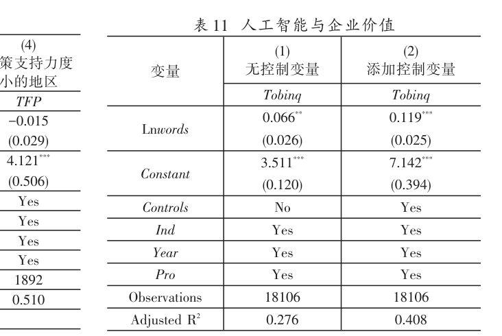

金、人才和技术方面提供更多的优惠政策，积极主动地加大新型基础设施建设的开发和投资，促进人工智能的稳步发展。

### （四）人工智能与企业价值

前文探究了人工智能的生产率效应，以及企业劳动力技能结构调整的过程。与此相关的另一个重要问题是，人工智能是否能够有效提升企业价值？对这一问题进行研究有助于更全面地评估人工智能的经济效应。前文发现人工智能通过促使企业减少对常规低技能劳动力的需求，增加对非常规高技能劳动力需求的方式提升企业的生产效率。因此，市场投资者应该对人工智能技术水平更高的企业给予更高的估值。我们构建模型（8）来考察人工智能对企业价值的影响：

（8）

Tobinqi,t = α + βAIi,t + γControlsi,t + year + ind + pro + εi,t

其中，Tobinq 表示企业价值。AI 为企业人工智能，用Lnwords 表示。其他变量定义与模型（3）一致。回归结果见表11，人工智能技术显著提高了企业价值，就经济意义而言，在控制其他因素后，企业人工智能水平Ln-words 每提高一个标准差，会使企业价值Tobinq 提高10.14%（0.852×0.119），在经济意义上也是显著的。该结果表明，市场投资者识别了人工智能技术在企业长期发展中发挥的积极作用，人工智能技术有助于企业调整劳动力技能结构进而提高企业生产效率，最终提升企业价值。

## 六、研究结论与政策启示

作为新一轮科技革命和产业变革的重要驱动力量，人工智能在提高企业生产率、推动经济增长方面具有重大潜力。但是由于数据瓶颈，在企业层面人工智能如何对生产率产生影响，以及企业劳动力技能结构在此过程中的变化尚未有明确的结论。本文收集了中国沪深A 股上市公司年报和专利文本数据，采用机器学习的方法生成了人工智能词典，进而构建了企业层面的人工智能指标。通过数据的描述性统计与实证研究，本文得出如下结论：（1）研究样本中约26.72%的年报中披露了人工智能相关信息，4.91%的上市公司申请了人工智

（2）人工智能显著提升了上市公司的生产率。在控制其能专利，我国各上市公司之间人工智能水平相差悬殊。他因素后，企业人工智能水平每提高一个标准差，会使企业全要素生产率提高3.24%。（3）机制分析表明，人工智能技术的使用会导致企业调整劳动力技能结构，具体表现为减少对常规低技能劳动力的需求，增加对非常规高技能劳动力的需求。（4）异质性研究表明：企业特征层面，在国有企业、技术型并购企业、劳动力保障较好企业、拥有技术型董事会的企业中，人工智能的生产率效应更显著。宏观因素层面，在高技术行业、要素市场

（5）本文进发育程度较高的地区以及政府支持力度较大的地区中，人工智能对企业生产率的提升作用更显著。一步发现人工智能提高了企业价值，在控制其他因素后，企业人工智能水平每提高一个标准差，会使企业价值提高10.14%。

为了更好地发挥人工智能的生产率效应，实现我国数字经济的健康发展，本文基于研究结论，聚焦微观企业视角，提出以下政策建议。

第一，引导企业坚定智能化的战略方向。本文发现目前我国上市公司之间人工智能技术水平差异悬殊。考虑到人工智能技术对企业的生产效率和企业价值存在显著的促进效应，建议在企业层面出台激励机制，从资金补助、税收减免等方面支持企业进行人工智能创新和应用，引导企业坚定智能化战略转型方向，抓住新一轮科技革命和产业变革的机遇，合理运用人工智能的前沿技术（如：通用型人工智能技术等）并与业务需求融合，提升自身生产效率。

第二，鼓励企业优化治理结构以适应技术变革。本文发现企业治理结构特征（如：技术型董事会）影响了人工智能的生产率效应。建议在政策层面引导企业积极调整治理结构，引入技术型人才进入决策层，或设置首席技术官（CTO）等技术决策岗位，对人工智能等新技术的使用进行更具专业性和战略性的决策，充分发挥技术型决策层对企业智能化转型的促进作用。

第三，引导企业通过多种方式加速劳动力技能结构调整。劳动力技能结构是人工智能技术促进企业生产效率提升的关键条件。但对企业而言，仅靠人才招聘和企业内部培养可能难以在短期内使自身劳动力技能结构发生根本性变化。本文发现技术型并购、产学研合作等方式可有效补充企业的高技能劳动力，强化人工智能的生产率效应。建议在政策层面鼓励企业通过技术型并购、产学研合作、技术人才的招聘、培养和激励等多种渠道并行，快速实现自身劳动力技能结构的调整。

第四，督促企业做好劳动力保障工作。由于人工智能技术使用对企业常规低技能劳动力存在显著的替代效应，企业在进行劳动力技能结构调整时会不可避免地产生低技能劳动力的失业问题。本文表明，如果企业的劳动力保障程度较低，也会限制人工智能技术有效发挥生产率效应。建议在政策方面，一方面引导企业加强劳动力保障制度建设，保障劳动者的合法权益；另一方面引导企业在人机交互能力、人工智能简单应用等新兴技能上对低技能劳动力开展职业培训，提高常规低技能劳动力适应人工智能技术环境的能力。

第五，加强引导民营企业的智能化转型。本文发现，民营企业在发挥人工智能的生产率效应方面还有待进一步提升。2023 年7 月发布的《中共中央国务院关于促进民营经济发展壮大的意见》提出要“着力推动民营经济实现高质量发展”。因此建议在政策方面加强对民营企业使用人工智能技术的引导，从政策、资金、人才、技术等方面加强对民营企业智能化转型给予的支持力度，并做好制度环境、产业环境和法治环境的有效保障。

未来的研究还可以进行如下拓展：划分具体行业，研究人工智能对银行、资产管理、证券业、保险业等具体

3等其他渠道探索如何提高微观企业层面人工智能的生产率效应，行业的影响。此外，还可以从资源优化组合

4。进一步拓展微观企业层面人工智能与经济学交叉学科的研究

（作者单位：姚加权，暨南大学管理学院；张锟澎，上海立信会计金融学院会计学院；郭李鹏，晋城市财政局；冯绪，天津大学管理与经济学部）

## 注释
力资源管理工作效率和人员运营效率得到有效提升。网址：https://www.xinrenxinshi.com/case-detail?caseId=1539849884675510274。

baijiahao.baidu.com/s?id=1697829030020977499&wfr=spider&for=pc。

台，该平台能够提供药物研发AI 模型、AI 算法以及药物知识图谱，帮助企业提高药物研发速度。网址：https://baijiahao.baidu.com/s?id=1685491311061326594&wfr=spider&for=pc。

智能指标，但是招聘广告只有2017 年和2018 年两年的数据，因此我们仅运用招聘广告数据进一步佐证本文的研究结论。

生产率作为稳健性检验，发现人工智能提高企业全要素生产率的结论依然稳健。

需求的方式提升了企业生产率”的研究结论依然保持稳健。

①例如，北京中电兴发科技有限公司采用数据化人力资源SaaS 产品“薪人薪事”，实现了人力资源工作流程的在线化和信息化，人

②例如，三一重工集团使用京东云RPA 智能对账机器人，有效降低财务人力成本的同时显著提高了财务工作效率。网址：https://

③例如，华为在研发人工智能技术的过程中，大力招聘药物研发算法工程师，进而开发了名为医药智能体（EIHealth）的AI 研发平

④我们还获取了智联招聘中上市公司招聘广告数据，以上市公司发布的人工智能招聘广告数量加1 的自然对数构建了企业人工

⑤值得说明的是，年报的目录也可能存在相关字眼并满足上述结构，我们对相关的目录部分进行了剔除。

⑥我们进一步基于CD 函数的LP 法（莱文森、彼得林，2003）和基于超越对数生产函数（Trans-log）的SFA 法重新测算企业的全要素

⑦我们还采用了企业层面聚类处理的做法，发现“人工智能通过促使企业减少常规低技能劳动力需求、增加非常规高技能劳动力

⑧我们进一步在基准回归模型中控制了企业研发投入和研发人员投入，人工智能提高企业生产率的研究结论依然稳健，由于企

业研发投入指标存在较多缺失值，导致本文的研究样本大幅度减少，因此，我们将该结果作为稳健性检验。

采用以样本中t-1 年的全国互联网上网人数（与时间相关，以百万为单位）与1984 年各城市每万人电话机部数（与个体变化相关）相乘后作为工具变量。一方面，人工智能是传统信息技术的延续发展，历史电信基础设施建设会影响当地的技术水平和使用习惯，进而影响后续企业对新技术的应用；另一方面电话机等作为传统电信工具，随着科技的发展，人们会降低对电话机的使用频率，传统电信工具也难以影响现阶段企业生产率，满足排他性。结果显示本文的研究结论依然稳健。

1我们进一步剔除了MD&A 中“未来发展的展望”部分，重新统计MD&A 剩余部分人工智能相关词频，构建企业人工智能指标，发现本文的研究结论依然保持稳健。

22017 年发布招聘广告的上市公司数量为2789 家，发布人工智能招聘广告的上市公司数量为223 家。2018 年发布招聘广告的上市公司数量为3240 家，发布人工智能招聘广告的上市公司数量为574 家。研究样本中，上市公司发布的招聘广告的最小值和最大值分别为0 和187470，上市公司发布的人工智能招聘广告的最小值和最大值分别为0 和142，招聘广告数量（人工智能招聘广告数量）的标准差大于均值，说明不同上市公司之间的招聘情况差距较大。

3考虑到上市公司年报和年报MD&A 部分有自我披露（Self-disclosure）的可能。因此本文除了统计上市公司年报和年报MD&A部分的人工智能词频外，还根据上市公司申请的人工智能专利和人工智能相关的招聘广告重新衡量企业人工智能，作为稳健性检验。

4从平均水平来说，与技术和研发人员相比，生产、业务、市场和财务人员从事的工作更趋于常规性和低技能性，因此本文将生产、业务、市场和财务人员界定为常规低技能劳动力，技术和研发人员界定为非常规高技能劳动力。

5我们尽可能全面地收集了人工智能对劳动力总量影响的权威文献。人工智能对劳动力总量的影响并未得出一致的结论。我们考察了人工智能对企业劳动力总量的影响，发现人工智能提高了企业的劳动力总量，这可能是规模效应和市场份额扩大造成的结果。然而，该结论只是短期的结果，目前我们还无法看到长期的结果，因此该结论需要谨慎对待。

6我们进一步控制了资源优化组合的影响，发现“人工智能通过促使企业降低常规低技能劳动力需求、增加非常规高技能劳动力需求进而提升企业生产效率”的研究结论依然保持稳健。

7例如，中国平安收购汽车之家后，通过整合汽车之家的研发团队，提高自身的技术水平和创新能力，并利用大数据和人工智能技术提高汽车保险和金融业务的效率和准确性。

8除企业之间的并购，本文还从企业的产学研情况展开异质性分析。产学研是上市公司与外部机构进行合作研发的重要途径，通过强化企业与科研院所之间的有效联动，不仅为企业训练并培养了一批高技能的科研人才，而且还有助于整合企业与科研机构的优质资源，推动科研成果产业化落地，从而促进企业技术创新。参照潘健平等（2019）以上市公司前十大股东中是否存在科研机构或者上市公司与高校等科研机构是否签署校企合作协议来度量企业的产学研合作情况并划分样本。研究发现，与非产学研合作型企业相比，产学研合作型企业中人工智能的生产率效应更显著。实证结果留存备索。

9此外，本文进一步考虑了企业作为被告方的劳动诉讼案件，根据企业当年是否被员工起诉（即是否劳动诉讼被诉）划分样本进行企业异质性分析。研究发现，人工智能对企业生产率的积极影响仅存在于未被员工起诉的样本组中。实证结果留存备索。

0例如，百度的技术型董事会有效推动了百度公司在人工智能领域的投资和创新，推出了语音识别和自然语言处理技术，并将其应用于公司的各个业务部门，提高了用户体验和服务效率。

1《中国分省份市场化指数报告（2018）》提供了2008~2016 年要素市场发育程度排序数据。由于各地区不同年度指数排序变化较小，所以本文使用2016 年的数据代表2017~2018 年的情况，根据地区要素市场发展程度分组检验的样本时间范围为2008~2018 年。

2由于“人工智能”于2017 年首次写入全国《政府工作报告》，所以在此我们仅考察2017~2018 年两年的数据样本。

3非常感谢审稿专家指出了资源优化组合这一非常具有价值的研究方向。

4中外文人名（机构名）对照：阿西莫格鲁（Acemoglu）；雷斯特雷波（Restrepo）；布林约尔松（Brynjolfsson）；弗曼（Furman）；西曼斯（Seamans）；爱德华兹（Edwards）；戈德法布（Goldfarb）；奥特（Autor）；弗雷（Frey）；奥斯本（Osborne）；陈（Chen）；斯里尼瓦桑（Srinivasan）；李（Li）；米科洛夫（Mikolov）；奥利（Olley）；帕克斯（Pakes）；索洛（Solow）；范（Fan）；纳恩（Nunn）；钱（Qian）；巴伦（Baron）；肯尼（Kenny）；阿查里亚（Acharya）；莱文森（Levinsohn）；彼得林（Petrin）。

## 参考文献
（1）蔡贵龙、郑国坚、马新啸、卢锐：《经济研究》，2018 年第9 期。

《国有企业的政府放权意愿与混合所有制改革》，

（2）陈彦斌、林晨、陈小亮：《经济研究》，2019 年第7 期。

《人工智能、老龄化与经济增长》，

（3）郭凯明：《管理世界》，2019 年第7 期。

《人工智能发展、产业结构转型升级与劳动收入份额变动》，

（4）郭凯明、王钰冰、龚六堂：《管理世界》，2023 年第6 期。

《劳动供给转变、有为政府作用与人工智能时代开启》，

（5）何小钢、梁权熙、王善骝：《管理世界》，2019 年第9 期。

（6）何瑛、于文蕾、戴逸驰、王砚羽：《管理世界》，2019 年第11 期。

《高管职业经历与企业创新》，

（7）胡元木、纪端：《南开管理评论》，2017 年第3 期。

《董事技术专长、创新效率与企业绩效》，《信息技术、劳动力结构与企业生产率——破解“信息技术生产率悖论”之谜》，

（8）黄群慧、余泳泽、张松林：《中国工业经济》，2019 年第8 期。

《互联网发展与制造业生产率提升：内在机制与中国经验》，

（9）李磊、王小霞、包群：《管理世界》，2021 年第9 期。

《机器人的就业效应：机制与中国经验》，

（10）林晨、陈小亮、陈伟泽、陈彦斌：《中国工业经济》，2020 年第2期。

（11）林建浩、赵子乐：

《均衡发展的隐形壁垒:方言、制度与技术扩散》，

（12）鲁晓东、连玉君：

《中国工业企业全要素生产率估计：1999—2007》，

（13）潘健平、潘越、马奕涵：《金融研究》，2019 年第1 期。

《以“合”为贵？合作文化与企业创新》，

《人工智能、经济增长与居民消费改善：资本结构优化的视角》，

《经济研究》，2017 年第9 期。

《经济学（季刊）》，2012 年第2 期。

⑨我们还参照黄群慧等（2019）和赵涛等（2020）的方法，基于各城市1984 年的邮电历史数据构建人工智能的工具变量。具体地，

⑩具体参见网址：http://www.gov.cn/xinwen/2016-12/09/5145438/files/2c008a9d525d477e8064574bcef998db.doc。

（14）施炳展、李建桐：《管理世界》，2020 年第4 期。

《互联网是否促进了分工：来自中国制造业企业的证据》，

（15）唐松、伍旭川、祝佳：《管理世界》，2020 年第5 期。

（16）王小鲁、樊纲、胡李鹏：

（17）王军、常红：《经济学动态》，2021 年第8 期。

《人工智能对劳动力市场影响研究进展》，《数字金融与企业技术创新——结构特征、机制识别与金融监管下的效应差异》，《中国分省份市场化指数报告（2018）》，社会科学文献出版社，2019 年。

（18）王林辉、胡晟明、董直庆：《中国工业经济》，2020 年第4期。

《人工智能技术会诱致劳动收入不平等吗——模型推演与分类评估》，

（19）王永钦、董雯：《经济研究》，2020 年第10 期。

《机器人的兴起如何影响中国劳动力市场？——来自制造业上市公司的证据》，

（20）谢谦、刘维刚、张鹏杨：《管理世界》，2021 年第2 期。

《进口中间品内嵌技术与企业生产率》，

（21）徐鹏、徐向艺：《管理世界》，2020 年第1 期。

《人工智能时代企业管理变革的逻辑与分析框架》，

（22）颜士梅：

《创业型并购不同阶段的知识员工整合风险及其成因——基于ASA 模型的多案例分析》，期。

《管理世界》，2012 年第7

（23）姚加权、张锟澎、罗平：《经济学动态》，2020 年第4 期。

《金融学文本大数据挖掘方法与研究进展》，

（24）叶康涛、孙苇杭：《会计研究》，2019 年第1 期。

《会计软件采用与企业生产率——来自非上市公司的证据》，

（25）余玲铮、魏下海、孙中伟、吴春秀：

《管理世界》，2021 年第1 期。据》，

《工业机器人、工作任务与非常规能力溢价——来自制造业“企业—工人”匹配调查的证

（26）张同斌、高铁梅：《经济研究》，2012 年第5 期。

《财税政策激励、高新技术产业发展与产业结构调整》，

（27）张叶青、陆瑶、李乐芸：2021 年第12 期。《大数据应用对中国企业市场价值的影响——来自中国上市公司年报文本分析的证据》，

《经济研究》，

（28）赵涛、张智、梁上坤：《管理世界》，2020 年第10 期。

《数字经济、创业活跃度与高质量发展——来自中国城市的经验证据》，

（29）赵健宇、陆正飞：《经济研究》，2018 年第10 期。

《养老保险缴费比例会影响企业生产效率吗？》，

（30）赵子夜、杨庆、杨楠：《管理科学学报》，2019 年第3 期。

《言多必失？管理层报告的样板化及其经济后果》，

（31）赵烁、施新政、陆瑶、刘心悦：《金融研究》，2020 年第10 期。

《兼并收购可以促进劳动力结构优化升级吗？》，

（32）朱焱、王广：

《技术型高管权力与非技术型高管权力对企业绩效的影响——来自中国A 股上市高新技术企业的实证检验》，《会计研究》，2017 年第12 期。

（33）Acemoglu，D. and Restrepo，P.，2018a，

（34）Acemoglu，D. and Restrepo，P.，2018b，and Employment”，American Economic Review，vol.108（6），pp.1488~1542.

（35）Acemoglu，D. and Restrepo，P.，2019，Economic Perspectives，vol.33（2），pp.3~30.

（36）Acharya，V. V.，Baghai，R. P. and Subramanian，K. V.，2014，ies，vol.27（1），pp.301~346.

（37）Autor，D. H.，Levy，F. and Murnane，R. J.，2003，Quarterly Journal of Economics，vol.118（4），pp.1279~1333.

（38）Baron，R. M. and Kenny，D. A.，1986，

“Artificial Intelligence，Automation and Work”，NBER Working Paper，No.w24196.

“The Race Between Man and Machine：Implications of Technology for Growth，Factor Shares，

“Automation and New Tasks：How Technology Displaces and Reinstates Labor”，Journal of

“Wrongful Discharge Laws and Innovation”，Review of Financial Stud-

“The Skill Content of Recent Technological Change：An Empirical Exploration”，

“The Moderator-Mediator Variable Distinction in Social Psychological Research：Conceptual，Strategic，and Statistical Considerations”，Journal of Personality and Social Psychology，vol.51（6），pp.1173~1182.

（39）Brynjolfsson，E.，Rock，D. and Syverson，C.，2017，tions and Statistics”，NBER Working Paper，No.w24001.

（40）Brynjolfsson，E.，Mitchell，T. and Rock，D.，2018，Economy”，AEA Papers and Proceedings，vol.108，pp.43~47.

（41）Chen，W. and Srinivasan，S.，2020，Paper，No.19-117.

（42）Edwards，J. S.，Duan，Y. and Robins，P. C.，2000，and in Different Roles”，European Journal of Information Systems，vol.9（1），pp.36~46.

（43）Fan，J. P.，Wong，T. J. and Zhang，T.，2013，mids”，Journal of Law，Economics，and Organization，vol.29（6），pp.1217~1252.

（44）Frey，C. B. and Osborne，M. A.，2017，Forecasting and Social Change，vol.114，pp.254~280.

（45）Furman，J. and Seamans，R.，2019，

（46）Goldfarb，A.，Taska，B. and Teodoridis，F.，2023，Emerging Technologies Using Data from Online Job Postings”，Research Policy，vol.52（1），104653.

（47）Levinsohn，J. and Petrin，A.，2003，ic Studies，vol.70（2），pp.317~341.

（48）Li，K.，Mai，F.，Shen，R. and Yan，X.，2021，vol.34（7），pp.3265~3315.

（49）Mikolov，T.，Sutskever，I.，Chen，K.，Corrado，G. S. and Dean，J.，2013，

“Artificial Intelligence and the Modern Productivity Paradox：A Clash of Expecta-

“What Can Machines Learn，and What Does It Mean for Occupations and the

“Going Digital：Implications for Firm Value and Performance”，Harvard Business School Working

“An Analysis of Expert Systems for Business Decision Making at Different Levels

“Institutions and Organizational Structure：The Case of State-owned Corporate Pyra-

“The Future of Employment：How Susceptible are Jobs to Computerisation”，Technological

“AI and the Economy”，Innovation Policy and the Economy，vol.19（1），pp.161~191.

“Could Machine Learning Be a General Purpose Technology？A Comparison of

“Estimating Production Functions Using Inputs to Control for Unobservables”，Review of Econom-

“Measuring Corporate Culture Using Machine Learning”，Review of Financial Studies，

“Distributed Representations of Words and Phrases and Their Compositionality”，In Advances in Neural Information Processing Systems，pp.3111~3119. （下转第133 页）

（34）Nocke，V. and Schutz，N.，2023，

“Merger Analysis with Sufficient Statistics”，Working Paper.

（35）Rochet，J. C. and Tirole，J.，2003，pp.990~1029.

（36）Rochet，J. C. and Tirole，J.，2006，

（37）Rysman，M.，2004，

“Platform Competition in Two-Sided Markets”，Journal of the European Economic Association，vol.1（4），

“Two-Sided Markets：A Progress Report”，The RAND Journal of Economics，vol.37（3），pp.645~667.

“Competition Between Networks：A Study of the Market for Yellow Pages”，The Review of Economic Studies，vol.71（2），pp.483~512.

（38）Sartzetakis，E. S.，1997，

“Raising Rivals’Costs Strategies via Emission Permits Markets”，Review of Industrial Organization，vol.12，pp.751~765.

（39）Salop，S. C.，1979，

“Monopolistic Competition with Outside Goods”，The Bell Journal of Economics，pp.141~156.

（40）Salop，S. C. and Scheffman，D. T.，1983，

（41）Salop，S. C. and Scheffman，D. T.，1987，

（42）Song，M.，2021，

“Raising Rivals’Costs”，The American Economic Review，vol.73（2），pp.267~271.

“Cost-Raising Strategies”，The Journal of Industrial Economics，pp.19~34.

“Estimating Platform Market Power in Two-Sided Markets with an Application to Magazine Advertising”，American Econom-ic Journal：Microeconomics，vol.13（2），pp.35~67.

（43）Tan，G. and Zhou，J.，2021，pp.1002~1030.

（44）Weyl，E. G.，2010，

（45）Wright，J.，2002，

“The Effects of Competition and Entry in Multi-Sided Markets”，The Review of Economic Studies，vol.88（2），“A Price Theory of Multi-Sided Platforms”，American Economic Review，vol.100（4），pp.1642~1672.

“Access Pricing under Competition：An Application to Cellular Networks”，The Journal of Industrial Economics，vol.50（3），pp.289~315.

The Welfare Analysis of Platform Operators Mergers: Market Positioning and Account Interoperability

Sun Zhen, Xu Xinzhen and Wang Yong

(Institute of Economics, School of Social Sciences, Tsinghua University)

Abstract: Operator mergers are a common pathway for platform development and a target of platform regulation. There is currently a lack of re-search on post-merger business strategies among platforms, making it difficult to establish an effective framework for welfare analysis. This study inno-vatively employs the Salop model to examine two primary strategies pursued by platform operators following mergers: market positioning and account interoperability. The aim is to assess their impact on price levels and user welfare and provide evaluative criteria for regulators. Our findings show that platform operators opt for increased differentiation between internal markets after a merger to reduce competition and boost profit margins, leading to a decline in user welfare; but allowing account interoperability following a merger is beneficial to user welfare. Crucially, changes in price levels af-ter a merger can serve as a criterion for evaluating the impact of platform mergers on user welfare. We also show that relative to improvements in net-work externality, cost reduction brought about by economies of scale is a more critical factor in enhancing user welfare. In the final part, we employ daily price data for homogeneous products sold before and after the merger between JD.com and Yihaodian to conduct an empirical test of our theoreti-cal model. Our findings provide important policy tools for regulation of platform operator concentration based on their business strategies and price lev-els.

Keywords：platform economy; business operator concentration; market positioning; interoperability; platform regulation

（50）Nunn，N. and Qian，N.，2014，

（51）Olley，G. S. and Pakes，A.，1996，vol.64（6），pp.1263~1297.

（52）Solow，R. M.，1987，

“We’d Better Watch Out”，New York Times Book Review，vol.12，pp.36.

## Abstract

Yao Jiaquan

“Food Aid and Civil Conflict”，American Economic Review，vol.104（6），pp.1630~1666.

“The Dynamics of Productivity in the Telecommunications Equipment Industry”，Econometrica，

c and Feng Xu

a, Zhang Kunpengb, Guo Lipeng d

(a. School of Management, Jinan University; b. School of Accounting, Shanghai Lixin University of Accounting and Finance;

c. Jincheng Finance Bureau; d. College of Management and Economics, Tianjin University)

Abstract: Artificial intelligence (AI) is of great importance for achieving high-quality economic development. Existing studies have most-ly focused on the impact of AI on the macro-economy. This paper examines how AI affects production efficiency and labor skill structure at the firm level. We use machine learning methods to create an AI dictionary. With the AI dictionary, we analyze the textual data of annual re-ports and patents of listed companies, and construct AI proxies at the firm level. The results show that AI significantly increases the productiv-ity of Chinese listed firms, and this finding is still valid after a series of robustness tests. In terms of mechanism, AI improves firms’produc-tivity by enabling firms to reduce the demand for conventional low-skilled labor and increase the demand for unconventional high-skilled la-bor, which reflects the labor skill structure adjustment. Heterogeneity analysis shows that firm-level factors such as the nature of property rights, talent acquisition methods, labor security, and governance structure affect the productivity effects of AI. In addition, the industry and re-gional level factors in which firms are located also influence the productivity effects of AI. Finally, we find that AI improves firm value. This paper deepens the cognition and understanding of the role of AI in the production process at firm-level, and gives recommendations to pro-mote the development of artificial intelligence technology for firms.

Keywords: artificial intelligence; firm productivity; labor skill structure adjustment; machine learning; artificial intelligence dictionary

## How Does Artificial Intelligence Improve Firm Productivity?

## Based on the Perspective of Labor Skill Structure Adjustment

c and Feng Xu

Yao Jiaquana, Zhang Kunpengb, Guo Lipeng d (a. School of Management, Jinan University; b. School of Accounting, Shanghai Lixin University of Accounting and

Finance; c. Jincheng Finance Bureau; d. College of Management and Economics, Tianjin University)

Summary: Artificial intelligence (AI) technology has developed rapidly in recent years, becoming a pivotal driv-ing force in the advancement of science and technology, the optimization and upgradation of industrial structures, and the overall boost in productivity. Most studies have focused on the macroeconomic impact of AI. However, the extent to which AI can improve productivity at the micro-enterprise level and how to adjust the labor skill structure of the enterprise to better leverage the efficiency improvement of AI technology remain unclear. This paper examines how micro-enterprises in China can adjust their labor skill structure in response to AI and investigates the impact of AI on productivity at the enterprise level.

This study uses machine learning techniques to develop an AI dictionary. We analyze textual data from the annu-al reports and patents of Chinese A-share listed companies on the Shanghai and Shenzhen stock exchanges to estab-lish firm-level AI proxies. Our empirical findings reveal that AI significantly improves the productivity of Chinese listed companies. This result remains consistent when we conduct a series of robustness tests, including propensity score matching, instrumental variable methods, "intelligent transformation of key industries" as a quasi-natural experi-ment, and alternative main AI indicators. In terms of mechanisms, AI enhances firm productivity by reducing the need for conventional low-skilled labor and elevating the demand for unconventional high-skilled labor. This reflects the adjustment of firms' labor skill structure. Further, this paper investigates how AI impacts firm productivity in dif-ferent firms, industries, and regions. The heterogeneity analysis indicates that firm-specific factors, such as property rights, talent acquisition methods, labor protection, and governance structures, exert significant impacts on the produc-tivity effects of AI. In addition, industry-and region-specific factors influence the productivity effects of AI. Finally, this paper further examines the impact of AI on firm value and finds that AI can significantly improve firm value.

This paper proposes the following policy implications for micro-enterprises. First, enterprises should be encour-aged to staunchly establish a strategic direction on intelligence. Second, enterprises should optimize their governance structures to adapt to technological changes. Third, enterprises should be supported to swiftly adjust their labor skill structure using diverse methods. Fourth, enterprises should be supervised to maintain robust labor protection stan-dards. Finally, directives for the intelligent transformation of private enterprises should be strengthened.

Our study contributes to the literature in the following ways. First, this study develops an AI dictionary through textual analysis by using machine learning techniques and establishes firm-level AI proxies, thereby providing an ef-fective tool and metrics for future research on firm-level AI. Second, focusing on the micro-enterprise level, this pa-per examines the impact of AI on firm productivity and investigates the crucial role of adjusting the labor skill struc-ture. At the practical level, this paper enhances the cognition and understanding of AI's role in the micro-enterprise production process. In addition, it offers insights to enterprises on how to adjust the labor skill structure to effectively improve the productivity effects of AI. Furthermore, this paper proposes policy implications for effectively harnessing the benefits of AI technology at both enterprise and policy levels to enhance the total factor productivity of enterpris-es.

Keywords: artificial intelligence; firm productivity; labor skill structure adjustment; machine learning; artificial intelligence dictionary

JEL Classification: D24, M12, O30

《人工智能如何提升企业生产效率？——基于劳动力技能结构调整的视角》附录

## 附录一：上市公司年报及专利摘要披露的人工智能信息示例

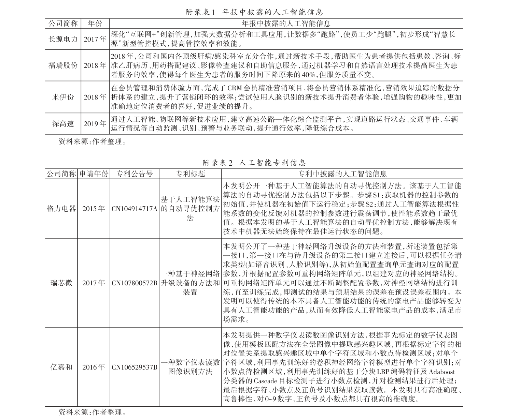

## 附录二：基于Word2vec 技术生成人工智能词典

#### 1.Word2vec 技术介绍

词嵌入（Word Embedding）是指将维数为所有词的数量的高维空间嵌入到低维连续向量空间的技术。通过词嵌入技术，可以将词语映射成低维连续向量空间中的向量，通过向量之间的距离和位置来表示文档中词语的上下文、语法和语义的相似性以及与其他词语的关系。Word2vec 是常用的词嵌入技术，可以通过训练使神经网络更好地捕捉到词语的上下文信息，从而将每个词语映射成更低维度、稠密且包含更多语义信息的向量（米科洛夫等，2013）。Word2vec 技术包括CBOW（Continuous Bag-of Words Model）模型和Skip-gram（Continuous Skip-gram Model）模型两种训练方法。

CBOW 模型认为每个词语都是由相邻的词语决定的，其中心思想为给定某个词语的上下文，通过训练好的模型预测出这个词语的生成概率。而Skip-gram 模型恰好相反，Skip-gram 模型认为每个词语决定了相邻的词语，其中心思想为给定某个词，通过训练好的模型预测出该词上下文中各个词的生成概率，如附录图1 所示。

为简化流程，以便理解，假设给定训练数据为“人工智能提高生产率”。首先采用独热（One-hot）编码得到大小为3 的语料库以及与语料库中的词一一对应的3 个3 维词向量，分别为：人工智能=[1，0，0]；提高=[0，1，0]；生产率=[0，0，1]。当采用CBOW 模型进行训练时，3 维词向量[1，0，0]和[0，0，1]作为模型的输入，经过中间层降低维度，然后经过输出层输出1 个同样是3 维的向量，包含了1 个概率，该概率代表着当前词与输入词一同出现在采样窗口的概率大小。当采用Skip-gram 模型进行训练时，3 维词向量[0，1，0]作为模型的输入，经过隐藏层降低维度，然后经过输出层输出2 个同样是3 维的向量，包含了2 个概率，每一个概率代表着当前词与输入词一同出现在采样窗口的概率大小，如附录图2 所示。

附录图1 CBOW 模型与Skip-gram 模型介绍

资料来源：作者绘制。

附录图2 CBOW 模型与Skip-gram 模型示例

资料来源：作者绘制。

#### 2. 训练Word2vec 模型

我们采用Python 中的gensim 工具包来训练Word2vec 模型，具体参数设定如下：（1）window size=5：该参数用来确定上下文窗口的最大值，默认值为5，即Word2vec 模型可以截取中心词左侧5 个词语和右侧5 个词语。（2）size=300：该参数用于指定词语向量的维数，当size 越大且有足够的训练集时，模型的训练效果越高，该值一般在几十至几百之间。参照李等（2021）我们将Size 设定为300。（3）iter=5：该参数用于设定迭代次数，默认值为5。（4）min_count=5：该参数设定对字典做截断的阈值，我们将该参数设定为5，即忽略在语料库中出现次数少于5 次的词语。（5）hs=1：该参数选择学习算法，我们将该参数设定为1，即选择Hierarchical Softmax 方法。（6）sg=1：对Word2vec 两个模型的选择。如果是0，为CBOW 模型，是1 则是Skip-gram 模型。我们选择sg=1，即Skip-gram 模型。

#### 3. 生成词典

（1）参考陈和斯里尼瓦桑（2020）提供的人工智能相关词语的中文翻译版，平安证券发布的《科创板系列——AI 产业链全景图》、中商产业研究院编制的《2019 年中国人工智能行业市场前景研究报告》、深圳前瞻产业研究院发布的《2019 年人工智能行业现状与发展趋势报告》等业界研究报告以及世界知识产权组织（World Intellectual Property Organization，WIPO）提供的人工智能词表，人工选取了52 个词语作为种子词（Seed Words）。（2）参考李等（2021），使用Word2vec（米科洛夫等，2013）技术，采用Skip-gram 模型，将年报和专利文本材料中的词语作为语料进行训练。根据种子词与输出词语之间的余弦相似度，针对每个种子词筛选出10 个与该种子词语义程度最相近的词语。然后，将重复词语、与人工智能不相关的词语以及词频过低的词语剔除，最终共获得73 个词语作

为本文的人工智能词典，具体词典如附录表3 所示。值得说明的是，在统计“支持向量机（SVM）”词频时，词频等于该词语中英文词频的加总。另外，由于卷积神经网络（CNN）等词语的英文缩写在年报中具有歧义，例如CNN 也可能表示美国有线电视新闻网（www.cnn.com），所以本文词典未纳入引起混淆的英文缩写。最后，因为统计的过程是在对文档的分词之后，并不是直接对原始文档进行统计，而分词后，独立的词语，分别统计个数。

## 附录三：人工智能技术水平指标的有效性验证

“神经网络”和“卷积神经网络”在统计个数时并不会重复统计，

“神经网络”和“卷积神经网络”会分为两个

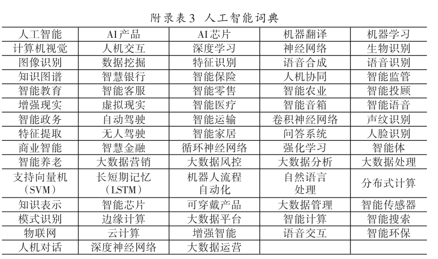

我们采用以下4 种方法考察上市公司年报人工智能词频与企业人工智能技术水平之间的关系，以确定上市公司年报人工智能词频能够在一定程度上反映企业人工智能技术水平。

（1）结合赛迪发布的《2019 赛迪人工智能企业百强榜研究报告》（详见https://www.sohu.com/a/334424478_610732）和同花顺网站上的人工智能概念股名单（详见http://q.10jqka.com.cn/gn/detail/code/302035）进行检验。其中，赛迪发布的《2019 赛迪人工智能企业百强榜研究报告》从基础指标、企业成长性、创新能力以及团队能力4 个维度评选人工智能企业，入选该榜单说明企业人工智能水平较高。人工智能概念股名单显示了入选人工智能概念股的上市公司名单。附录表4 的Panel A 和Panel B 为上市公司年报人工智能词频Words的检验结果，该结果显示，赛迪榜单中上市公司年报人工智能词频均值为69.387，显著大于非赛迪榜单上市公司年报人工智能词频均值2.806。人工智能板块上市公司年报人工智能词频均值为21.967，显著大于非人工智能板块上市公司年报人工智能词频均值2.245。附录表4 的Panel C 和Panel D 为上市公司年报MD&A 部分人工智能词频Words_MD&A 的检验结果，该结果与附录表4 的Panel A 和Panel B 的结果类似。由此，我们认为上市公司年报中人工智能的词频在一定程度上能够衡量企业的人工智能技术水平。

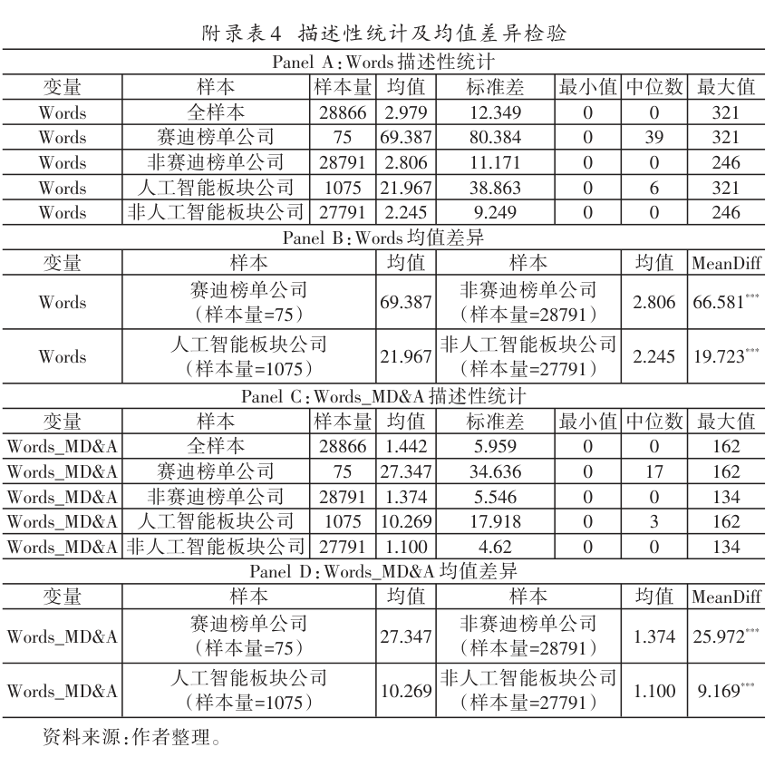

（2）对企业人工智能的不同指标进行相关性检验。文章构建的企业人工智能的变量包括：上市公司年报的人工智能词频Ln-words、上市公司年报MD&A 部分的人工智能词频Lnwords_MD&A、上市公司申请的人工智能专利数Lnpatents 以及上市公司发布的人工智能招聘广告数LnAIad。这些指标从上市公司年报、人工智能专利和人工智能招聘广告3 方面的文本数据中反映企业的人工智能技术水平，使得不同数据来源能够相互印证企业的人工智能技术水平。我们进一步对这些变量进行Pearson 相关性检验，如附录表5 所示。上市公司年报中人工智能词频Lnwords 与Lnwords_MD&A、Lnpatents 和LnAIad 的相关系数分别为0.909、0.272 和0.286 均在1%水平上显著正相关，这表明这4 个指标均在一定程度上反映了企业的人工智能水平。

变量

Lnwords

Lnwords_MD&A

Lnpatents

LnAIad

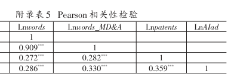

（3）参照张叶青等（2021）的逻辑，企业人工智能技术的应用伴随着智能平台、软件以及技术引进等无形资产投入。尽管企业数字化投资无法完全表征企业人工智能技术水平，但企业人工智能与这些数字化投资相关。因此，我们基于上市公司财务数据构建Invest-ment 变量为企业在“软件”、

“网络”、

“客户端”、

“管理系统”和“智能平台”等数字化无形资产投入金额占企业总无形资产投资金额的比重，将Investment 变量作为被解释变量与本文构建的人工智能指标回归，结果如附录表6 所示，本文构建的企业人工智能指标与In-vestment 显著正相关，这也间接印证了本文人工智能指标的有效性。

变量

Lnwords

Lnwords_MD&A

Lnpatents

LnAIad

Constant

Controls

Ind

Year

Pro

Observations

Adjusted R2

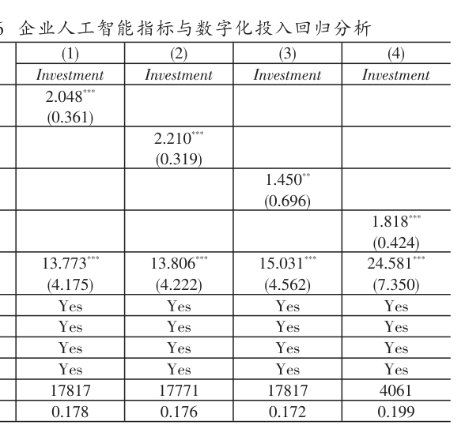

（4）人工打分与年报词频比较检验。我们随机抽取了20 份上市公司年报，寻找了两名具有人工智能业界经验的从业者，让这两位从业者根据上市公司年报对上市公司的人工智能技术水平进行打分（即分为高、低两个程度），然后和上市公司年报中人工智能的

《广州御银科技股份有限公司2017 年度报告》（股票代码：002177）中“第三节公司业务概要”部分的核心竞争力词频进行对比。例如，分析中提到“探索人工智能技术”、“公司独有囊括强大信息量的智能管理云平台”，在“第四节经营情况讨论与分析”中，从智能化设备和生物识别等方面概述了公司目前人工智能技术的应用情况。基于以上信息，将其判定为高分。

《张家港保税科技股份有限公司2016 年年度报告》（股票代码：600794）中，公司仅从企业信誉和品牌优势、规模优势和区位优势等方面分析了企业的核心竞争力，并未将技术优势囊括在企业的核心竞争力方面，此外，年报其他内容也没有涉及人工智能技术应用的相关描述。基于以上信息，将其判定为低分。

人工打分结果和年报词频进行对比发现，打分为高分的上市公司年报的人工智能词频较高，人工智能词频均值为41.70；打分为低分的上市公司年报的人工智能词频较低，人工智能词频均值为1.40。这在一定程度上反映了上市公司年报词频能够反映企业的人工智能技术水平。具体情况如附录表7 所示①。

序号

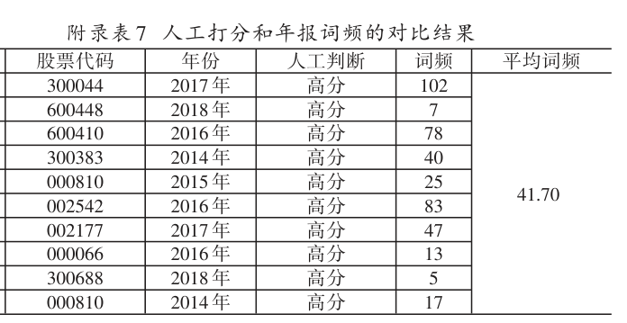

## 注释
## 参考文献
（1）张叶青、陆瑶、李乐芸：2021 年第12 期。

（2）Chen，W. and Srinivasan，S.，2020，Paper，No.19-117.

（3）Li，K.，Mai，F.，Shen，R. and Yan，X.，2021，vol.34（7），pp.3265~3315.

（4）Mikolov，T.，Sutskever，I.，Chen，K.，Corrado，G. S. and Dean，J.，2013，Compositionality”，In Advances in Neural Information Processing Systems，pp.3111~3119.

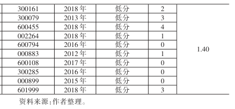

《大数据应用对中国企业市场价值的影响——来自中国上市公司年报文本分析的证据》，

《经济研究》，

“Going Digital：Implications for Firm Value and Performance”，Harvard Business School Working

“Measuring Corporate Culture Using Machine Learning”，Review of Financial Studies，

“Distributed Representations of Words and Phrases and Their

①中外文人名（机构名）对照：米科洛夫（Mikolov）；陈（Chen）；斯里尼瓦桑（Srinivasan）；李（Li）。
